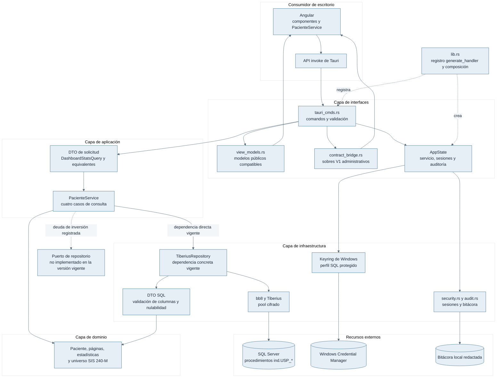
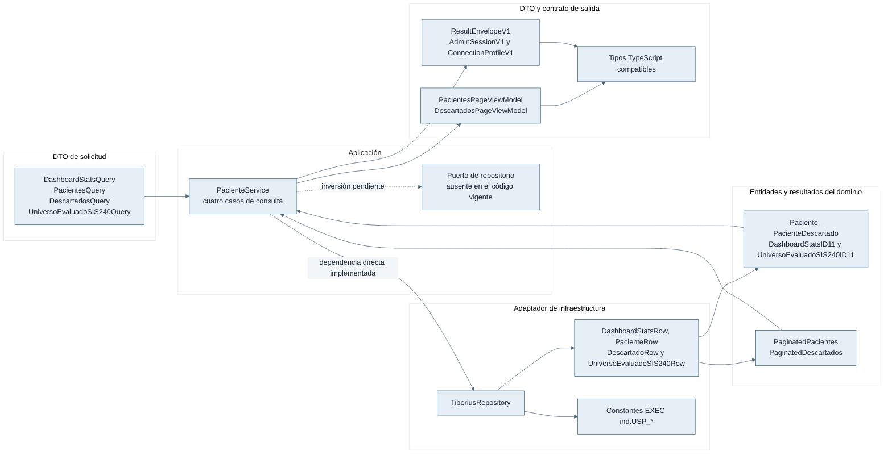
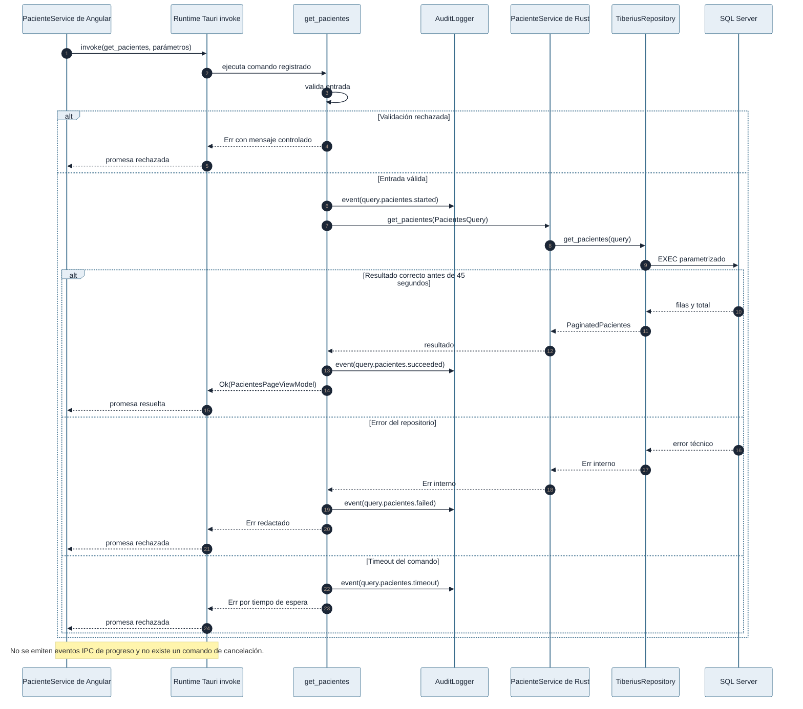

# Arquitectura del backend Rust y Tauri

## Capas

| Capa | Ruta | Responsabilidad |
|---|---|---|
| Dominio | `src-tauri/src/domain` | Entidades del indicador, páginas, estadísticas y universo evaluado |
| Aplicación | `src-tauri/src/application` | DTO de solicitud y coordinación de los cuatro casos de consulta |
| Infraestructura | `src-tauri/src/infrastructure` | Tiberius, pool, consultas, lectura estricta de filas y DTO SQL |
| Interfaces | `src-tauri/src/interfaces` | Comandos Tauri, perfiles, sesión, traducción de errores y modelos para Angular |
| Composición | `src-tauri/src/lib.rs` | Estado, registro, comandos permitidos y ciclo de Tauri |

El dominio no depende de Tauri, Tiberius, WinVault ni Angular. La interfaz valida y transforma, y `lib.rs` es la única composición que registra los comandos públicos mediante `tauri::generate_handler!`.

La estructura sigue límites hexagonales, pero la inversión no está completa:
`application/paciente_service.rs` importa directamente
`infrastructure/db/tiberius_repository.rs` y no existe un trait de repositorio
en dominio o aplicación. Esta deuda se documenta para evitar una garantía falsa.
La introducción futura del puerto debe ser aditiva, conservar DTO y casos de uso,
y permitir una implementación simulada sin cambiar las interfaces IPC.

## Diagrama completo de arquitectura y dependencias



El diagrama distingue la estructura deseada de la dependencia ejecutable. La ruta clínica vigente conecta `PacienteService` directamente con `TiberiusRepository`; el nodo de puerto indica una ausencia comprobada y no un componente disponible. La interfaz crea las solicitudes, obtiene el servicio almacenado en `AppState`, proyecta los resultados mediante modelos compatibles y, en los comandos administrativos versionados, usa el puente de contratos. `lib.rs` concentra el registro de comandos y la construcción del estado, por lo que no traslada reglas clínicas hacia la composición.

## Estado y flujo

`AppState` conserva el autenticador, sesiones, pool SQL, perfil activo y registrador de auditoría bajo primitivas de sincronización. Una solicitud sigue este recorrido:

1. Angular invoca un comando registrado.
2. La interfaz valida tipos, periodo, paginación, orden y sesión.
3. El comando obtiene el servicio o prepara una conexión candidata.
4. El repositorio ejecuta exclusivamente las sentencias `EXEC ind.USP_*` declaradas en `infrastructure/db/queries.rs`.
5. `dto.rs` exige presencia, tipo y nulabilidad de columnas antes de construir el dominio.
6. El puente de contratos crea un sobre `hra.desktop.v1` sin diagnósticos internos.

## Conexión y TLS

El modo estricto mantiene `EncryptionLevel::Required`, usa `native-tls` sobre Schannel, exige TLS 1.2 o superior y valida el certificado. El modo `legacy_tls` selecciona antes de conectar el OpenSSL vendorizado, conserva cifrado, permite TLS 1.0 como mínimo y restringe el destino a una IP privada o loopback. No existe reintento con el otro proveedor.

La selección se implementa en el parche documentado por [`src-tauri/vendor/tiberius/HRA_PATCH.md`](../../src-tauri/vendor/tiberius/HRA_PATCH.md). Las notas del proveedor no sustituyen la política de seguridad de la aplicación.

## Compatibilidad de nombres

Los tipos heredados `PacientesPageViewModel`, `DescartadosPageViewModel` y propiedades `snake_case` se mantienen por compatibilidad. No constituyen la nomenclatura objetivo. Un contrato nuevo debe usar español, sufijo `VistaModelo` o `RespuestaDto` y JSON `camelCase`; cualquier transición será aditiva y versionada.

## Verificación

```powershell
npm ci
npm run check
cargo test --manifest-path src-tauri/Cargo.toml
cargo fmt --manifest-path src-tauri/Cargo.toml -- --check
cargo clippy --manifest-path src-tauri/Cargo.toml --all-targets -- -D warnings
```

La validación de una instancia SQL real requiere un entorno autorizado y se describe en [integración con base de datos](INTEGRACION_BASE_DATOS.md).

## Anexo consolidado: guia de desarrollo

> Procedencia: `docs/manuales/GUIA_DE_DESARROLLO.md`. El archivo de origen se retiró después de incorporar íntegramente este contenido y recalcular sus enlaces relativos.

<details>
<summary>Contenido técnico consolidado desde <code>docs/manuales/GUIA_DE_DESARROLLO.md</code></summary>

### Metadatos del documento de origen

```yaml
title: "Guía de desarrollo de Base Tauri"
subtitle: "Entorno Angular, Rust, pruebas y mantenimiento de contratos"
author: "Ing. Havel CONTRERAS TAPAHUASCO"
date: "2026-08-20"
last_updated: "2026-08-20"
document_type: "guía técnica"
status: "vigente"
canonical: true
application: "base_tauri_angular"
version: "1.6.1"
```


### Guía de desarrollo de Base Tauri

#### Prerrequisitos

Se requieren Windows, Node.js 22, npm compatible con el lock, Rust con edición 2021, WebView2 y las herramientas de compilación de Microsoft. El desarrollo no necesita una instancia SQL para las pruebas unitarias y de contrato; la prueba funcional de consultas sí requiere una instancia autorizada.

#### Preparación y ejecución

Desde la raíz:

```powershell
npm ci
npm run desktop:dev
```

`npm run desktop:dev` delega en `scripts\dev.bat`; Tauri inicia Angular en `http://localhost:1420`. El frontend no debe abrirse como aplicación operativa independiente porque las funciones de backend sólo existen dentro de Tauri.

#### Pruebas y compuertas

```powershell
npm run check:types
npm run check:angular
npm run db:validate:sps
npm run check
cargo test --manifest-path src-tauri/Cargo.toml
cargo fmt --manifest-path src-tauri/Cargo.toml -- --check
cargo clippy --manifest-path src-tauri/Cargo.toml --all-targets -- -D warnings
```

`npm run check` valida Atomic, contratos de base de datos, secretos, recuperador, evidencia, Angular y compilación. `db:validate:sps` analiza fuentes locales sin ejecutar SQL. La prueba de conexión usa una configuración temporal y no debe tocar WinVault real durante pruebas automatizadas.

#### Cambios de IPC

Un comando nuevo debe incorporarse en la interfaz, registrarse en `src-tauri/src/lib.rs`, validar su solicitud, devolver un sobre seguro y tener pruebas Rust y TypeScript. Los archivos `contracts/generated` se regeneran desde `@hra/desktop-contracts@0.3.1`; no se editan manualmente.

#### Cambios SQL

El repositorio Rust sólo contiene llamadas parametrizadas `EXEC ind.USP_*`. Una modificación de alias o nulabilidad exige actualizar el procedimiento, `infrastructure/db/dto.rs`, el dominio, los contratos de escritorio, las pruebas y el diccionario. La fuente SQL puede consultar tablas `stg` directamente cuando esa decisión esté versionada; no debe ocultarse bajo una afirmación general de consumo exclusivo de vistas.

#### Recuperador

El recuperador es un crate separado. Sus comandos de construcción y verificación son `npm run admin-recovery:build`, `admin-recovery:verify-build`, `admin-recovery:stage` y `admin-recovery:verify`. Las pruebas deben usar almacenes aislados y nunca Windows Credential Manager real.

#### Cierre documental

Cada cambio actualiza el manual afectado, `CHANGELOG.md` y `LESSONS_LEARNED.md`. Los documentos antiguos se conservan como históricos con `canonical: false` y `superseded_by`.

</details>

## Anexo consolidado: contratos backend

> Procedencia: `docs/manuales/CONTRATOS_BACKEND.md`. El archivo de origen se retiró después de incorporar íntegramente este contenido y recalcular sus enlaces relativos.

<details>
<summary>Contenido técnico consolidado desde <code>docs/manuales/CONTRATOS_BACKEND.md</code></summary>

### Metadatos del documento de origen

```yaml
title: "Contratos del backend Rust"
subtitle: "Dominio, servicio, repositorio, errores e invariantes"
author: "Ing. Havel CONTRERAS TAPAHUASCO"
date: "2026-08-20"
last_updated: "2026-08-21"
document_type: "contrato técnico"
status: "vigente"
canonical: true
application: "base_tauri_angular"
version: "1.6.1"
```


### Contratos del backend Rust

#### Dominio y aplicación

`domain/paciente.rs` define estadísticas, pacientes, descartados, páginas y universo evaluado. `application/dto.rs` representa solicitudes y `application/paciente_service.rs` coordina los cuatro casos de consulta. El dominio no importa Tauri ni Tiberius.

##### Entidades y resultados

| Tipo | Contenido e invariante |
|---|---|
| `DashboardStatsID11` | Totales, numerador, denominador, porcentaje, métodos, insumos, condición `D`/`R` y serie mensual |
| `MonthlyStat` | Mes, porcentaje y promedio de un punto de la serie |
| `Paciente` | Fila nominal completa; `dni_paciente` es obligatorio y los contadores son enteros |
| `PaginatedPacientes` | Colección `data` y conteo total |
| `PacienteDescartado` | Identidad nominal, obstetra, fecha y motivo de descarte |
| `PaginatedDescartados` | Elementos, total, página, tamaño y páginas totales |
| `UniversoEvaluadoSIS240ID11` | Discriminador `v_tabla`, periodo, conteos de universo y `v_estado` |

##### Casos de uso vigentes

| Método de aplicación | Solicitud | Puerto IPC que lo activa | Resultado |
|---|---|---|---|
| `get_dashboard_stats_id11` | `DashboardStatsQuery` | `get_dashboard_stats_id11` | `DashboardStatsID11` |
| `get_universo_evaluado_sis240_id11` | `UniversoEvaluadoSIS240Query` | `get_universo_evaluado_sis240_id11` | `UniversoEvaluadoSIS240ID11` |
| `get_pacientes` | `PacientesQuery` | `get_pacientes` | `PaginatedPacientes` |
| `get_descartados` | `DescartadosQuery` | `get_descartados` | `PaginatedDescartados` |

Los DTO de solicitud se construyen después de validar periodo, paginación,
búsqueda y orden en la interfaz. El servicio no debe aceptar una sentencia SQL,
un nombre de procedimiento ni credenciales como entrada de estos casos.

| Contrato | Garantía |
|---|---|
| Periodo | Mes 1–12 y año dentro del rango permitido |
| Paginación | Página y tamaño positivos dentro del máximo |
| Orden | Columna y dirección incluidas en listas permitidas |
| Búsqueda | Longitud limitada y enviada como parámetro |
| Resultado SQL | Columna, tipo y nulabilidad comprobados antes de construir dominio |
| Timeout | 45 segundos para consultas; 10 segundos para conexión |
| Error | Código/categoría segura, sin diagnóstico del controlador |

#### Repositorio

`infrastructure/db/tiberius_repository.rs` implementa las consultas permitidas declaradas en `queries.rs`. No recibe SQL arbitrario. El pool sólo se activa después de una prueba. Una conexión fallida no sobrescribe el perfil activo.

La dependencia vigente de `PacienteService` es el tipo concreto
`TiberiusRepository`; el repositorio no declara todavía un trait de puerto en
`domain` o `application`. La separación de carpetas conserva una frontera
hexagonal parcial, pero la inversión de dependencias no está completa. No se
debe afirmar que infraestructura implementa un puerto inexistente. La evolución
compatible consiste en introducir un trait asíncrono en la capa de aplicación,
adaptar Tiberius y mantener los cuatro casos y sus resultados sin cambios.

#### Relación entre dominio, casos de uso, puerto ausente, adaptador y DTO



El flujo ejecutable evita el nodo de puerto porque ese trait todavía no existe: `PacienteService` almacena un `TiberiusRepository`. Los DTO de solicitud también conservan nombres de propiedades en inglés, y los modelos de salida mantienen el sufijo `ViewModel`; ambas formas son compatibilidad, no la norma para nuevos contratos. Los DTO SQL son privados del adaptador y convierten filas sólo después de validar la forma de los conjuntos. Los sobres compartidos se usan en las fronteras administrativas versionadas; los comandos clínicos actuales devuelven modelos concretos de manera directa. La evolución deberá incorporar un puerto en aplicación y DTO en español de manera aditiva, sin afirmar que esa inversión ya está disponible.

#### Seguridad transversal

`security.rs` administra hash, intentos y sesiones; `audit.rs` redacta eventos; `admin_recovery_runtime.rs` comparte las invariantes del recuperador. Las capas de datos no deben validar contraseñas ni escribir logs clínicos.

#### Contratos compartidos

`@hra/desktop-contracts@0.3.1` se materializa en `contracts/generated/rust/contracts.rs`. El lock vigente contiene el bundle `0c54533d135ed96128aba43be41e620c024d498cae146d2ed0ef3e93487608aa`. Los archivos generados y el lock no se editan manualmente.

Los tipos heredados con `ViewModel` y `snake_case` son compatibilidad. Un contrato nuevo debe usar español y JSON `camelCase`; la migración se introduce con alias o versión nueva.

#### Pruebas

```powershell
cargo test --manifest-path src-tauri/Cargo.toml
npm run check:contracts
npm run db:validate:sps
```

Las pruebas de repositorio deben comprobar consultas, parámetros, mapeo y errores sin abrir la instancia clínica.

</details>

## Anexo consolidado: contratos api ipc

> Procedencia: `docs/manuales/CONTRATOS_API_IPC.md`. El archivo de origen se retiró después de incorporar íntegramente este contenido y recalcular sus enlaces relativos.

<details>
<summary>Contenido técnico consolidado desde <code>docs/manuales/CONTRATOS_API_IPC.md</code></summary>

### Metadatos del documento de origen

```yaml
title: "Contratos API e IPC de Base Tauri"
subtitle: "Comandos registrados, solicitudes, sobres y límites de confianza"
author: "Ing. Havel CONTRERAS TAPAHUASCO"
date: "2026-08-20"
last_updated: "2026-08-21"
document_type: "contrato IPC"
status: "vigente"
canonical: true
application: "base_tauri_angular"
version: "1.6.1"
contract_version: "hra.desktop.v1"
```


### Contratos API e IPC de Base Tauri

#### Registro público

`src-tauri/src/lib.rs` registra exactamente estos comandos: `get_admin_auth_status`, `authenticate_admin`, `bootstrap_admin_password`, `revoke_admin_session`, `get_pacientes`, `get_dashboard_stats_id11`, `get_universo_evaluado_sis240_id11`, `connect_db`, `connect_db_stored`, `get_admin_session_v1`, `get_connection_profile_v1`, `connect_db_v1`, `test_connection_v1` y `get_descartados`.

Los comandos sin sufijo `v1` permanecen por compatibilidad. Las operaciones administrativas versionadas devuelven el sobre `hra.desktop.v1`.

#### Solicitudes principales

| Comando | Entrada | Salida |
|---|---|---|
| `authenticate_admin` | contraseña | sesión secreta interna para el proceso |
| `get_admin_session_v1` | token administrativo | metadatos públicos de sesión en `ResultEnvelopeV1` |
| `get_connection_profile_v1` | token | perfil sin contraseña o ausencia controlada |
| `test_connection_v1` | token, servidor, base, usuario, contraseña, `legacy_tls` | booleano y metadatos; no persiste |
| `connect_db_v1` | token y credenciales validadas | perfil activado después de prueba |
| `get_dashboard_stats_id11` | mes, año | estadísticas del indicador 11 |
| `get_pacientes` | página, tamaño, búsqueda, estado, orden, periodo, método, estado TA | página nominal |
| `get_descartados` | periodo, página, límite, búsqueda | página de descartados |
| `get_universo_evaluado_sis240_id11` | mes, año | universo y estado SIS 240 |

#### Sobre seguro

`ResultEnvelopeV1` contiene versión de contrato, identificador de solicitud, `ok`, datos o error y metadatos. El error expone código, categoría, reintento, clave de mensaje, parámetros escalares y etapa. No expone `Display` de Tiberius, dirección privada, cadena, token ni búsqueda.

`ConnectionProfileV1` publica servidor, puerto, base, usuario, modo TLS, revisión y referencia opaca de credencial. `AdminSessionV1` publica identificador, emisión, expiración, alcance y las garantías de vínculo al proceso y no persistencia.

#### Validación y errores

Las solicitudes se rechazan por formato, rango, periodo, sesión, política TLS o ausencia de runtime. Los fallos SQL se clasifican como timeout, indisponibilidad, contrato incompatible, dato inválido u operación fallida. Un error desconocido se transforma en `INTERNAL_ERROR`.

#### Eventos, progreso y cancelación

El contrato vigente es exclusivamente solicitud/respuesta mediante `invoke`.
`src-tauri/src` no registra ni emite eventos Tauri de dominio, progreso o datos;
los `EventEmitter` de los componentes Angular son internos a la interfaz y no
forman parte del IPC. En consecuencia, ningún consumidor debe esperar eventos
`started`, `progress`, `completed` o `failed` desde Rust.

No existe un comando IPC de cancelación de consultas ni un token de cancelación
aceptado por los comandos registrados. El `request_id` de `ResultEnvelopeV1`
sirve para correlación y no autoriza cancelar. La interfaz usa `RequestSequence`
en las vistas de tablero y descartados para invalidar respuestas visuales
anteriores cuando cambia el filtro; esa invalidación evita pintar un resultado
obsoleto, pero no garantiza que SQL Server haya detenido la consulta. Rust
aplica un timeout de 45 segundos y descarta el futuro cuando vence. El comando
`revoke_admin_session` revoca sólo la sesión administrativa, no una consulta SQL.

Si se incorpora cancelación real, el cambio requiere un comando o identificador
versionado, propagación hasta Tiberius/SQL Server, definición de idempotencia,
pruebas de carrera y una nueva versión del contrato. Hasta entonces, el
consumidor sólo puede ignorar una respuesta obsoleta y esperar el timeout.

#### Secuencia pública de éxito, error y señales internas



Las llamadas `AuditLogger.event` del diagrama escriben señales de auditoría dentro del proceso Rust; no son eventos entregados a Angular. La frontera pública es solicitud/respuesta: un éxito resuelve la promesa con el modelo concreto y un error la rechaza con texto redactado. `RequestSequence` sólo evita que una respuesta anterior actualice la vista después de un cambio de filtro; no cancela Tiberius ni SQL Server. Los comandos administrativos V1 siguen otra proyección y devuelven `ResultEnvelopeV1`, por lo que el consumidor debe distinguir ambas formas mientras continúe la compatibilidad vigente.

#### Evolución

Un cambio incompatible requiere una versión nueva y convivencia temporal. El registro de `generate_handler!`, los contratos generados, el puente TypeScript, las pruebas y este documento deben actualizarse juntos.

</details>

## Anexo consolidado: guia de desarrollo

> Procedencia: `docs/recuperacion-administrativa/GUIA_DE_DESARROLLO.md`. El archivo de origen se retiró después de incorporar íntegramente este contenido y recalcular sus enlaces relativos.

<details>
<summary>Contenido técnico consolidado desde <code>docs/recuperacion-administrativa/GUIA_DE_DESARROLLO.md</code></summary>

### Metadatos del documento de origen

```yaml
title: "Guía de desarrollo del recuperador administrativo"
subtitle: "Arquitectura, construcción reproducible y validación del helper Win32"
author: "Ing. Havel CONTRERAS TAPAHUASCO"
date: "2026-08-15"
document_status: "active"
application_version: "1.6.1"
status: "vigente"
version: "1.6.1"
audience: "Desarrollo, seguridad y aseguramiento de calidad"
production_ready: false
```


### Guía de desarrollo del recuperador administrativo

#### Objetivo técnico

El recuperador administrativo constituye un ejecutable Windows separado de la
aplicación Tauri. El diseño reutiliza la política y el núcleo de recuperación,
pero evita depender del crate principal y de su superficie Tauri, Wry, WebView,
Tiberius, OpenSSL y SQL. Esta separación reduce el grafo ejecutable y permite
construir, revisar y firmar el helper como un artefacto independiente.

La interfaz predeterminada es una ventana Win32 nativa. El modo de consola
permanece disponible exclusivamente con `--reset`. Ninguna variante recibe la
contraseña mediante argumentos o variables.

#### Inventario de fuentes y responsabilidades

| Ruta | Responsabilidad |
|---|---|
| [`admin-recovery.product.json`](../../admin-recovery.product.json) | Contrato canónico del producto, la credencial, el mutex, la interfaz y el nombre versionado del artefacto. |
| [`src-tauri/admin-recovery/Cargo.toml`](../../src-tauri/admin-recovery/Cargo.toml) | Crate mínimo, dependencias cerradas y target `configure_admin_password`. |
| [`src-tauri/admin-recovery/src/main.rs`](../../src-tauri/admin-recovery/src/main.rs) | Enrutamiento entre GUI, contingencia CLI y resultados del proceso. |
| [`src-tauri/admin-recovery/src/native_admin_gui.rs`](../../src-tauri/admin-recovery/src/native_admin_gui.rs) | Ventana Win32, controles protegidos, navegación, validación previa y limpieza de campos. |
| [`src-tauri/src/admin_recovery_cli.rs`](../../src-tauri/src/admin_recovery_cli.rs) | Parser cerrado de argumentos y requisito de terminal interactiva para `--reset`. |
| [`src-tauri/src/admin_recovery_runtime.rs`](../../src-tauri/src/admin_recovery_runtime.rs) | Mutex compartido, precedencia del entorno, política de contraseña, Argon2id y escritura en Windows Credential Manager. |
| [`scripts/configure_admin_password.bat`](../../scripts/configure_admin_password.bat) | Invocación del crate auxiliar desde el árbol fuente. |
| [`scripts/admin-recovery-release.mjs`](../../scripts/admin-recovery-release.mjs) | Build doble reproducible, inspección PE, recibo, SBOM, staging y verificación QA. |
| [`scripts/admin-recovery-bundle-source.mjs`](../../scripts/admin-recovery-bundle-source.mjs) | Preparación y comprobación de la copia firmada que consumen los bundles. |
| [`scripts/windows-release-policy.mjs`](../../scripts/windows-release-policy.mjs) | Política Authenticode, roles exactos y bloqueos de promoción. |
| [`scripts/stage-windows-release.mjs`](../../scripts/stage-windows-release.mjs) | Descubrimiento de los cuatro binarios Windows y generación de la evidencia principal. |
| [`scripts/release-artifacts.mjs`](../../scripts/release-artifacts.mjs) | SBOM combinado, manifiesto, sumas y verificación de la entrega completa. |
| [`scripts/verify-admin-recovery-installation.ps1`](../../scripts/verify-admin-recovery-installation.ps1) | Vinculación del helper instalado y su acceso del menú Inicio con la evidencia exacta. |
| [`src-tauri/tauri.conf.json`](../../src-tauri/tauri.conf.json) | Inclusión del helper firmado como recurso y compuerta previa al bundle. |
| [`src-tauri/nsis/installer-hooks.nsh`](../../src-tauri/nsis/installer-hooks.nsh) | Creación y eliminación del acceso directo en NSIS. |
| [`src-tauri/wix/admin-recovery-shortcut.wxs`](../../src-tauri/wix/admin-recovery-shortcut.wxs) | Componente WiX del acceso directo para MSI. |

#### Contrato canónico del producto

El manifiesto raíz utiliza `schemaVersion: 2` y debe contener exactamente diez
claves. Cualquier clave faltante, adicional o divergente detiene las compuertas
de versión y de construcción.

| Clave | Valor vigente o regla |
|---|---|
| `applicationId` | `com.havelcontreras.base-tauri-angular` |
| `artifactName` | `HRA-Modulo-Operativo-Tauri-Recuperacion-Administrativa-1.6.1-Beta.exe` |
| `artifactRole` | `administrative-recovery-utility` |
| `cliFallback` | `true` |
| `credentialTarget.service` | `pe.gob.hra.modulo-operativo` |
| `credentialTarget.account` | `admin-password-hash-argon2id-v1` |
| `defaultInvocation` | `gui` |
| `interfaceMode` | `native-win32-gui` |
| `mutexName` | `Global\HRA.ModuloOperativoTauri.AdminCredential.Runtime.v1` |
| `productVersion` | La misma versión semántica de todas las fuentes del proyecto. |
| `schemaVersion` | `2` |

El objeto tiene diez claves de nivel superior; las dos propiedades de
`credentialTarget` forman un único destino estructurado. La versión también
deberá coincidir en `package.json`, `package-lock.json`,
`src-tauri/tauri.conf.json`, ambos `Cargo.toml`, ambos `Cargo.lock`, el entorno
Angular, el componente visible, el servicio de versión, el changelog y las
fuentes de accesos MSI/NSIS. La comprobación se ejecuta mediante:

```powershell
node scripts\sync-version.js --check
```

#### Flujo de ejecución

La frontera pública sigue la secuencia siguiente:

1. `parse_recovery_invocation` acepta cero argumentos para GUI o exactamente
   `--reset` para consola. Cualquier otra forma se rechaza antes de consultar el
   almacén seguro.

2. `acquire_admin_recovery_guard` crea el mutex global compartido con la
   aplicación. La existencia previa del mutex impide una ejecución concurrente.

3. `ensure_admin_recovery_environment_allowed` comprueba la presencia de
   `HRA_ADMIN_PASSWORD_HASH` y `HRA_TAURI_ADMIN_PASSWORD_HASH`. La comprobación
   se repite inmediatamente antes de escribir.

4. La GUI mantiene dos campos `ES_PASSWORD` y sólo habilita la confirmación
   cuando ambos valores son iguales y cumplen la política. La CLI requiere
   entrada y mensajes conectados a una terminal interactiva.

5. `reset_local_admin_password` genera un PHC Argon2id con sal aleatoria y
   reemplaza exclusivamente el destino vigente del usuario en Windows
   Credential Manager.

6. Los valores temporales se mantienen en contenedores con borrado y los
   controles GUI se limpian después del intento.

El proceso se compila con subsistema `WINDOWS_GUI`; la contingencia intenta
adjuntarse a la consola del proceso padre. La solicitud de privilegios del
recurso PE es `asInvoker`, por lo que el contexto de identidad continúa siendo
el usuario dueño de la credencial.

#### Límites de seguridad que no deberán ampliarse

- El helper no deberá importar el crate de aplicación ni componentes Tauri,
  Wry o WebView.

- El helper no deberá exponer IPC, escuchar puertos ni consultar SQL Server,
  Kafka o Nexus.

- El helper no deberá leer, migrar ni eliminar el destino heredado de la
  contraseña administrativa.

- El helper no deberá aceptar el secreto por argumentos, entrada redirigida,
  archivo `.env` o archivo de configuración.

- El helper no deberá compartir destino de credencial o mutex con otro
  producto.

- Un error de almacén no deberá declarar una reversión si Windows no permite
  determinar el resultado de la escritura.

- La evidencia QA no deberá marcar `productionReady=true`.

#### Requisitos del entorno de desarrollo

La construcción se realiza en Windows x64 con Node.js 22, npm, el toolchain
Rust estable para `x86_64-pc-windows-msvc`, MSVC y los componentes del SDK de
Windows requeridos por Win32. El crate auxiliar usa su propio `Cargo.lock` y
Cargo se ejecuta con `--locked --offline`.

Después de una limpieza de dependencias, la aplicación Angular y los bundles
requieren:

```powershell
npm ci
```

La construcción del helper no importa paquetes de `node_modules`, pero sí
requiere el ejecutable Node.js, npm, Cargo y todas las dependencias Rust ya
disponibles para el modo offline. La ausencia de una dependencia en la caché de
Cargo deberá resolverse por el procedimiento institucional de preparación del
entorno; no se deberá retirar `--offline` de la compuerta para resolverla.

Cuando la política de PowerShell impida cargar `npm.ps1`, se deberá invocar
`npm.cmd` en lugar de `npm`. Por ejemplo, `npm.cmd run check:atomic` ejecuta el
mismo script sin modificar ni el repositorio ni la política de ejecución del
equipo.

#### Construcción reproducible del helper

El build sólo admite un árbol Git limpio. `SOURCE_DATE_EPOCH` debe coincidir
exactamente con la fecha Unix de `HEAD`; por ello, toda modificación aprobada
deberá confirmarse antes de construir.

```powershell
$env:SOURCE_DATE_EPOCH = git show -s --format=%ct HEAD
npm run admin-recovery:build
npm run admin-recovery:verify-build
npm run admin-recovery:stage
npm run admin-recovery:verify
Remove-Item Env:SOURCE_DATE_EPOCH
```

`admin-recovery:build` elimina únicamente el target auxiliar permitido,
construye en dos directorios independientes y exige igualdad SHA-256 bit a bit.
También valida la frontera de dependencias, los imports PE, la ausencia de rutas
locales, los metadatos de versión y la firma deliberadamente ausente de QA.

#### Directorios y archivos generados

| Ruta | Contenido |
|---|---|
| `src-tauri/target/admin-recovery/cargo-target/independent-a` | Primer target limpio de Cargo. |
| `src-tauri/target/admin-recovery/cargo-target/independent-b` | Segundo target limpio de Cargo. |
| `src-tauri/target/admin-recovery/build-output` | Helper versionado y `build-receipt.json`. |
| `src-tauri/target/admin-recovery/review` | Entrega QA cerrada de seis archivos. |
| `src-tauri/target/admin-recovery/bundle-source` | Helper firmado e inventario que consumirá Tauri. |
| `src-tauri/target/release` | Aplicación principal y bundles generados por Tauri. |
| `src-tauri/target/release-evidence` | Evidencia principal con los cuatro binarios. |

La entrega `review` deberá contener exactamente:

```text
HRA-Modulo-Operativo-Tauri-Recuperacion-Administrativa-1.6.1-Beta.exe
admin-recovery.product.json
build-receipt.json
release-manifest.json
sbom.cdx.json
SHA256SUMS.txt
```

Todas estas rutas se encuentran ignoradas por Git y pueden eliminarse y
regenerarse. La carpeta central
`D:\Repos2\_entregables_qa\recuperacion-administrativa` es un archivo de QA
separado y no reemplaza los directorios del pipeline.

#### Pruebas y compuertas

Las compuertas que no requieren `node_modules` deberán ejecutarse aun cuando la
limpieza haya eliminado las dependencias instaladas:

```powershell
npm run check:atomic
npm run check:contracts
npm run check:database-contracts
npm run check:secrets
npm run test:admin-recovery
npm run test:release
node scripts\sync-version.js --check
```

`test:release` no requiere paquetes Node instalados, pero su prueba de
descubrimiento exacto exige una entrega
`src-tauri/target/admin-recovery/review` vinculada al `HEAD` vigente. Si la
limpieza eliminó esa salida, la prueba deberá fallar de forma cerrada hasta que
el helper vuelva a construirse y prepararse después del commit.

Después de `npm ci` se deberán ejecutar además las compuertas Angular y el
conjunto completo:

```powershell
npm run check:types
npm run check:angular
npm test
npm run build
npm audit --audit-level=moderate
npm run check
```

Las compuertas Rust del crate principal se ejecutan desde `src-tauri`:

```powershell
cargo fmt --check
cargo check --locked
cargo clippy --locked --all-targets -- -D warnings
cargo test --locked
```

La QA estática no deberá ejecutar el PE, abrir Windows Credential Manager ni
alterar credenciales reales. La prueba funcional deberá reservarse para una
cuenta Windows desechable y una entrega autorizada.

#### Procedimiento de modificación

1. Se deberá confirmar el alcance y mantener separados el contrato del producto,
   la interfaz y el núcleo de seguridad.

2. Se deberán actualizar pruebas junto con cualquier cambio de parser, política,
   destino, mutex, interfaz o pipeline.

3. Cuando cambie la versión, se deberán actualizar todas las fuentes controladas
   por `sync-version.js` en el mismo commit.

4. Se deberán ejecutar las compuertas sin dependencias y, cuando corresponda,
   las compuertas completas después de `npm ci`.

5. Se deberá crear un commit selectivo sin incluir `src-tauri/target`, secretos,
   certificados ni salidas generadas.

6. Sólo después del commit y con el árbol limpio podrá definirse
   `SOURCE_DATE_EPOCH` y construirse la nueva evidencia.

7. La evidencia de un commit anterior deberá conservar su identificador y no
   podrá presentarse como evidencia del `HEAD` nuevo.

#### Documentos relacionados

- [Manual de usuario](MANUAL_DE_ADMINISTRACION.md)

- [Guía de despliegue](GUIA_DE_DESPLIEGUE.md)

- [Decisión del recuperador distribuible](../decisions/ADR-014-recuperador-administrativo-distribuible.md)

- [Decisión sobre interfaz Win32 y distribución](../decisions/ADR-016-interfaz-win32-y-distribucion-del-recuperador-1-6-1.md)

</details>
